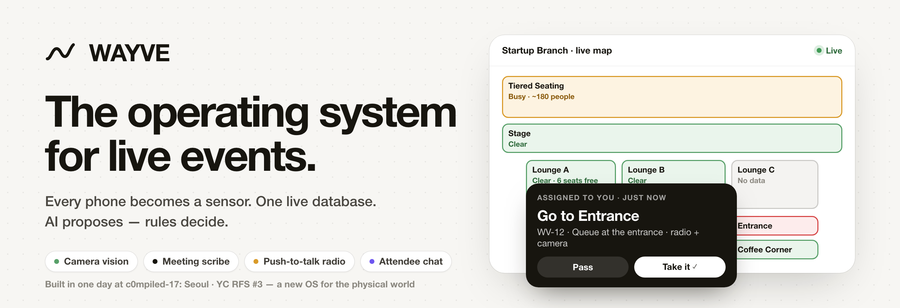
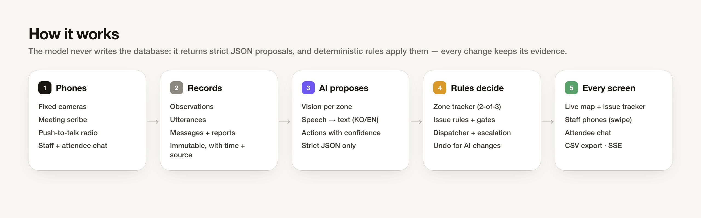
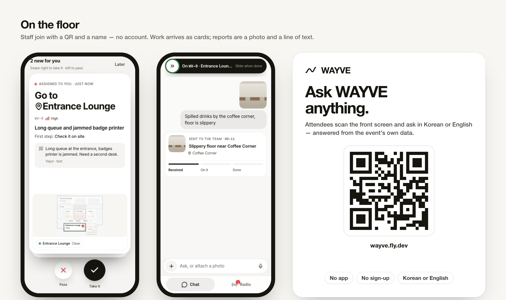

<p align="center">
  
</p>

<p align="center">
  <a href="https://wayve.fly.dev"><b>Live demo → wayve.fly.dev</b></a>
  &nbsp;·&nbsp; Built in one day at <b>c0mpiled-17: Seoul</b> (COEX Startup Branch, Nov 9 2026)
  <br>YC Request for Startups #3 — <i>a new operating system for the physical world</i>
</p>

<p align="center">
  
  
  
  
  
  
</p>

---

Events still run on radios, phone calls and group chats. **WAYVE** turns every phone at the venue into a sensor —
fixed cameras, a meeting scribe, push-to-talk radio, staff and attendee chat — and lands it all in **one live database**
that HQ, field staff and an AI crew act on. Nobody types into a tracker: work shows up where it happened, with evidence.

<p align="center"></p>

## What it does

| Channel | Device | What WAYVE extracts | Where it lands |
| --- | --- | --- | --- |
| **Camera vision** | Fixed phones (one zone, or several — preset spots ship default regions) | Crowd level, people, queue + wait, free seats, walkway, hazards | Zone tracker → live map, alerts, incidents |
| **Meeting scribe** | A phone on the meeting table or the stage desk | Tasks, owners, deadlines, decisions | Issue tracker, with the exact quote as evidence |
| **Radio** | Staff phones (push-to-talk) | Transcript (Korean, English or mixed), "done" / "blocked" | Radio log with acks + issue changes |
| **Field reports** | Staff chat: photos or a short video + one line | Title, category, urgency, place, summary | Linked issue (same-spot reports merge) |
| **Attendee chat** | Attendee phones (QR poster or the front screen) | Answers from the event info, requests, problems | Tickets the attendee can follow live |
| **Staff assistant** | Dashboard (⌘K) and staff phones (chat + voice) | Answers from the live DB, commands ("mark WV-3 done") | Inline maps, issue cards, applied actions |

An **AI crew** — Queue Watcher, Safety Sentinel, Crowd Analyst, Meeting Secretary, Dispatcher, Concierge — is bound to
devices, radios zone changes to HQ, dispatches unowned issues to the best available person (a pass re-offers it to the
next one), and watches every issue until it is resolved.

<p align="center"></p>

## Built for a real floor

- **QR in, no accounts.** Staff and devices join with a QR and a name; only the organizer dashboard has a login.
  Staff, camera and scribe links carry an organizer join key — the attendee poster code can only join as an attendee.
- **Korean and English.** Chat and voice replies follow the language of each message (decided in code, not guessed);
  dashboard records stay English; transcripts keep the words as spoken. Silence and prompt echoes never become messages.
- **The model never writes the database.** It returns strict-JSON proposals; deterministic rules apply them (auto above a
  confidence bar, otherwise into a Suggestions inbox). Every change keeps its evidence, and AI changes can be undone.
- **Steady numbers.** The zone tracker smooths single frames (median of the last ≤ 5, hysteresis, 2-of-3 confirmation for hazards).
- **Private by default.** No raw video or continuous audio is stored: frames and audio are analysed in memory and dropped;
  radio clips expire after 6 h.
- **Venue presets.** Startup Branch ships its real floor plan, 8 zones, a stage install plan (two cameras, one scribe, the
  attendee QR on the front screen), a printable install sheet and the event's own info for the assistants.

## Business model

Event operations as a service: organizers pay per event-day, venues pay monthly. Full model, unit economics and go-to-market:
[docs/BUSINESS.md](docs/BUSINESS.md).

| Free | Event Pass | Pro Event | Venue | Enterprise |
| --- | --- | --- | --- | --- |
| ₩0 · 1 event, 50 attendees | **₩290,000 / event-day** · up to 500 people | ₩790,000 / event-day · up to 3,000 | ₩1,900,000 / month · unlimited events | from ₩30M / year · festivals, SLA |

~80–85% gross margin per Event Pass day (AI and hosting ≈ ₩30–60k). No hardware: it runs on the phones staff already carry.

## Surfaces

| Who | Where | What |
| --- | --- | --- |
| Organizer | `/e/:eventId/…` (login) | Dashboard (issue tracker), Map, Radio, Assistant, AI crew, Database (live tables + CSV), Devices, Reports, People, Settings |
| Staff | `/staff` (QR + a name) | **Chat** (assistant; attach photos or video) and **Radio** (push-to-talk). New tasks arrive as swipe cards: right to take, left to pass |
| Devices | `/device/:id`, `/scribe/:id` (QR) | A camera that reads its zones every few seconds; a scribe that transcribes the table |
| Attendees | `/chat` (poster or front screen) | Ask anything in Korean or English; requests become tracked tickets |

## Stack

Node 24 (TypeScript via type stripping) · Express · `node:sqlite` (single writer, WAL, migrations on boot) · in-process SSE ·
React 19 · Vite · Tailwind 4 · motion · OpenAI (`gpt-6-luna`, `gpt-4o-mini-transcribe`, `gpt-4o-mini-tts`) · Fly.io (one machine + volume).

## Run locally

```bash
npm install
cp .env.example .env        # set OPENAI_API_KEY (leave empty to run without AI: manual observations only)
npm run dev                 # API on :8080, web on :5173
node scripts/seed-venue.mjs http://localhost:8080   # optional demo venue (accounts saved to data/demo-credentials.json)
```

Checks: `npm run typecheck`, `npm test`, `bash scripts/verify-all.sh` — build + unit tests + every smoke suite against a
fresh local server with the real models (needs `OPENAI_API_KEY`).

## Deploy

`node scripts/deploy.mjs` — typecheck, build, `fly deploy --ha=false`, then waits for the new release to report healthy.
Secrets live in Fly (`fly secrets set OPENAI_API_KEY=… EVENT_WIFI_PASSWORD=…`); nothing secret is committed.

<p align="center"><sub>WAYVE · made at c0mpiled-17: Seoul</sub></p>
